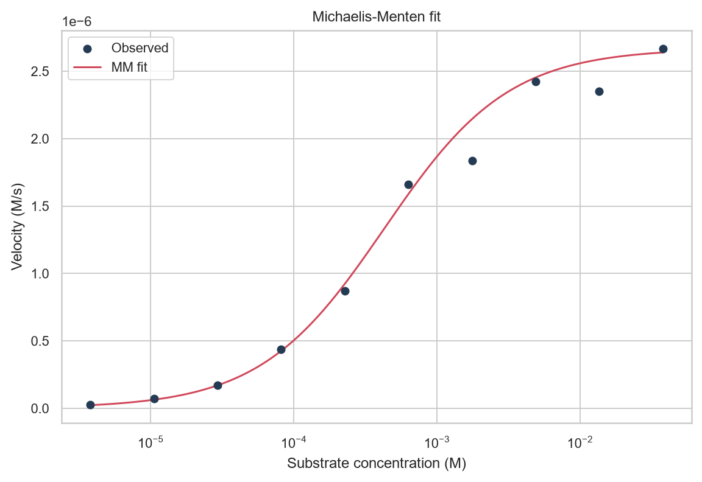

# MM Kinetics

Fit Michaelis-Menten curves and estimate parameter uncertainty with bootstrapping.
Requires Python 3.11+. From the repository root:

```bash
python -m pip install -r requirements.txt
python -m mm_kinetics.pipeline --config configs/default.yaml
python -m pytest tests -ra
```

On Linux or macOS, use `python3` if needed. Windows uses the same commands.

Settings are in `configs/default.yaml`. Runs produce tables in `data/synthetic`
and `data/processed`, plots in `figures`, fitted models in `models`, and JSON
metrics at `reports/generated/metrics.json`. Git ignores these outputs.

Demonstrations include reaction simulation, weighted and unweighted curve fitting,
and paired-data and lognormal parametric bootstrap intervals. Five regressors
predict log10 Km, kcat, or efficiency, with MAE, RMSE, and R² for evaluation.

The default uses 100 enzymes: 40 for training and 20 each for validation,
calibration, and testing. Validation RMSE selects the model; its bootstrap ensemble
trains only on training assays. Calibration uses each enzyme's maximum absolute
residual at rank `ceil((n + 1) * confidence_level)` among n calibration enzymes.
Coverage is measured per assay and across every assay within each test enzyme.
This assumes exchangeable calibration and test enzymes and their assay collections;
shared families or protocols can violate that assumption.

Fewer than 19 calibration enzymes give unbounded 95% intervals with no useful
precision. CSVs and saved calibrators retain infinite bounds; JSON uses `null`
for nonfinite numbers and records interval status.



## Local SABIO-RK exports

The loader accepts CSV/TSV exports with enzyme and substrate identities plus
`Km`/`kcat` values and units, or long-form parameter type/value/unit columns.
Rejected rows retain their reasons. Set these fields in the YAML configuration:

```yaml
data:
  source: sabio
  sabio_export_path: data/raw/assays.tsv
  sabio_retrieval_date: "YYYY-MM-DD"
  sabio_query: your original query
```

SABIO-RK provides reported parameters for ML, not raw substrate/velocity curves.
Kinetic demonstrations still use synthetic data. Original units are retained and
converted to mol/L, mol/L/s, 1/s, and K; supply missing units. Keep the export,
query, retrieval date, and usage terms. Synthetic results do not establish
experimental performance.
